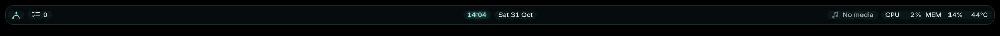

<h1 align="center">Zenith</h1>

<p align="center"><b>The lightest beautiful status bar for Wayland.</b></p>

<p align="center">
  <a href="https://aur.archlinux.org/packages/zenith-bar"></a>
  <a href="LICENSE"></a>
  <a href="https://github.com/CPT-Dawn/Zenith/actions/workflows/bench.yml"></a>
</p>

<p align="center">
  
</p>

Zenith does nothing unless something on the bar changes. No polling helpers, no animations running in the background, a clock that wakes on the minute. And it still looks like the screenshot above: smoked glass, a mint neon accent, one glowing focal element.

It runs on any compositor with `wlr-layer-shell`: Hyprland (most tested), Sway, niri, river and friends.

## Install

```sh
paru -S zenith-bar
```

Not on Arch? [Build from source](docs/installation.md#from-source): GTK 4.22+, gtk4-layer-shell and Rust.

Then start it from your compositor. On Hyprland, with blur for the glass look:

```ini
exec-once = zenith-bar
layerrule = blur on, match:namespace zenith-bar
layerrule = ignore_alpha 0.3, match:namespace zenith-bar
```

Sway, niri and river snippets are in [installation](docs/installation.md#compositor-notes).

## Configure

No config file is needed: the default is the bar in the screenshot. To make it yours:

```sh
zenith-bar init      # writes ~/.config/zenith-bar/config.toml, every default commented
```

Every key is optional, so a config only holds what you change:

```toml
[bar]
position = "bottom"
monitors = ["DP-1"]

[layout]
left = ["logo"]
center = ["clock"]
right = ["media", "system"]

[theme]
name = "tokyo-night"
accent = "#ff79c6"
```

Save, and the bar updates. A typo keeps the last good config running; `zenith-bar check` says exactly what's wrong:

```text
config.toml:2:1: unknown key `heigth` in [bar] (did you mean `height`?)
```

A published [JSON Schema](docs/configuration.md#editor-autocomplete-the-json-schema) gives your editor autocomplete, and gives AI assistants an exact contract.

## Presets and themes

Start from a curated look with one command:

```sh
zenith-bar init --preset bloom     # floating glass, glowing clock (the default look)
zenith-bar init --preset minimal   # flush, no glow, no motion: the leanest Zenith
zenith-bar init --preset classic   # the Zenith 1.x layout in Tokyo Night
```

Themes: **Midnight Bloom** (default), **Tokyo Night**, **Catppuccin Mocha** and **Gruvbox Dark**. Override the accent, opacity or radius in one line, or restyle anything with your own `style.css` on top of documented `--zb-*` variables and `zb-*` classes.

## Numbers

Measured by the [benchmark harness](docs/performance.md) in a headless Sway (`gles2` renderer) on one laptop (Intel Core i7-13700HX, Arch Linux, GTK 4.24.1), median of three runs, 30 s idle window:

| | Zenith 1.x | Zenith 2, `bloom` | Zenith 2, `minimal` |
|---|---|---|---|
| Idle CPU | 17.132 % | 0.000 % | 0.000 % |
| Wakeups | 196.55 /s | 1.23 /s | 0.27 /s |
| Time to first frame | 281 ms | 194 ms | 189 ms |
| Proportional memory (PSS) | 92.9 MiB | 58.4 MiB | 58.1 MiB |

Resident memory is 145.6 MiB for `bloom`, most of it shared GTK, font and GPU driver mappings, and it moves with the machine's page cache: read [performance](docs/performance.md) before quoting it. CI holds every preset to its [performance budgets](docs/performance.md#v2-budgets) on every code change.

## Docs

- [Installation](docs/installation.md): AUR, source build, Hyprland, Sway, niri and river notes
- [Configuration](docs/configuration.md): every key with its default and an example
- [Theming](docs/theming.md): themes, motion, the focal element, every variable and class
- [Performance](docs/performance.md): method, hardware and full results
- [Migrating from 1.x](docs/migrating-from-v1.md): v2 is a clean break; start here
- [Contributing](CONTRIBUTING.md) and the [changelog](CHANGELOG.md)

## License

[MIT](LICENSE) © Swastik Patel
