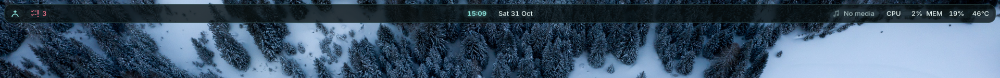

<div align="center">


# Zenith

**The lightest beautiful status bar for Wayland.**

A GTK4 status bar for Hyprland, Sway, niri and river that sleeps until something on it changes.<br>
Smoked glass and a glowing clock, at zero idle CPU and about one wakeup a second.

[](https://github.com/CPT-Dawn/Zenith/releases/latest)
[](https://github.com/CPT-Dawn/Zenith/actions/workflows/bench.yml)
[](https://aur.archlinux.org/packages/zenith-bar-bin)
[](LICENSE)

[Install](#install) · [Quick start](#quick-start) · [Documentation](docs/README.md) · [Contributing](CONTRIBUTING.md)



<sub>Midnight Bloom on Hyprland, the wallpaper blurred through the glass. A real capture, not a mock-up.</sub>

</div>

## Why Zenith

- **Idle means idle.** 0.000 % CPU and 1.23 wakeups/s at idle, where Zenith 1.x burned 17 % and 196/s ([measured](docs/performance.md#v1-and-v2-side-by-side) on an i7-13700HX, median of three runs). One event-driven main loop, no polling helpers, and CI fails any change that breaks a preset's [performance budget](docs/performance.md#v2-budgets).
- **Beautiful with no config.** The default is smoked glass, a mint accent and one glowing clock. Four themes and three presets are one line away: see the [gallery](docs/theming.md#gallery).
- **A typo can't break it.** Config and `style.css` reload on save. A bad edit keeps the last good config running, and `zenith-bar check` names the line, column and fix.
- **Restyle anything.** Your own `style.css` sits on top of documented `--zb-*` variables and `zb-*` classes, and a JSON Schema gives your editor autocomplete.
- **Clipboard history on the bar.** With [Hoarder](https://github.com/CPT-Dawn/Hoarder), the `clipboard` module shows your recent copies, image thumbnails included. Click one to restore it.
- **Your CI runners at a glance.** The `runners` module shows a dot per GitHub Actions self-hosted runner (running, idle, offline) and the jobs waiting for one. Click for what each runner is doing and for how long.

## Install

```sh
paru -S zenith-bar-bin
```

<details>
<summary>Other ways to install</summary>

**AUR, built from source**

```sh
paru -S zenith-bar
```

**Release tarball** (any glibc distro with GTK 4.22+ and gtk4-layer-shell): extract `zenith-bar-<version>-x86_64.tar.gz` from the [latest release](https://github.com/CPT-Dawn/Zenith/releases/latest) and put `zenith-bar` on your `PATH`.

**From source** (needs Rust 1.97+, GTK 4.22+ and gtk4-layer-shell 1.3+)

```sh
git clone https://github.com/CPT-Dawn/Zenith.git && cd Zenith
cargo build --release --locked
sudo install -Dm755 target/release/zenith-bar /usr/local/bin/zenith-bar
```

</details>

Zenith needs a compositor with `wlr-layer-shell`: Hyprland (most tested), Sway, niri, river and friends. GNOME and KDE are not supported.

## Quick start

```sh
zenith-bar
```

1. The bar appears in the default Midnight Bloom look. No config file is needed.
2. Start it at login and blur the glass. On Hyprland (`hyprland.lua`):

   ```lua
   hl.on("hyprland.start", function() hl.exec_cmd("zenith-bar") end)
   hl.layer_rule({
       name = "zenith-bar-blur", match = { namespace = "^zenith-bar$" },
       blur = true, ignore_alpha = 0.3,
   })
   ```

   The `hyprland.conf`, Sway, niri and river versions are in [installation](docs/installation.md#compositor-notes).
3. Make it yours: `zenith-bar init --preset minimal` (or `bloom`, `classic`) writes `~/.config/zenith-bar/config.toml`. Edit it, save, and the bar updates.

`zenith-bar --help` lists every command and option.

## Documentation

| Guide | What it covers |
| --- | --- |
| [Installation](docs/installation.md) | AUR, release tarball, source build, and every compositor's setup |
| [Configuration](docs/configuration.md) | Every key with its default, `check`, and the JSON Schema |
| [Theming](docs/theming.md) | The gallery, themes, motion, and every CSS variable and class |
| [Performance](docs/performance.md) | The benchmark method, hardware, full results and budgets |
| [Migrating from 1.x](docs/migrating-from-v1.md) | What moved in the v2 rewrite, and the old screenshots |
| [Changelog](CHANGELOG.md) | What changed in each release |

## Contributing

Bug reports, theme ideas and pull requests are all welcome. [CONTRIBUTING.md](CONTRIBUTING.md) has the setup, the checks to run and how the screenshots are taken.

## License

[MIT](LICENSE) © Swastik Patel
